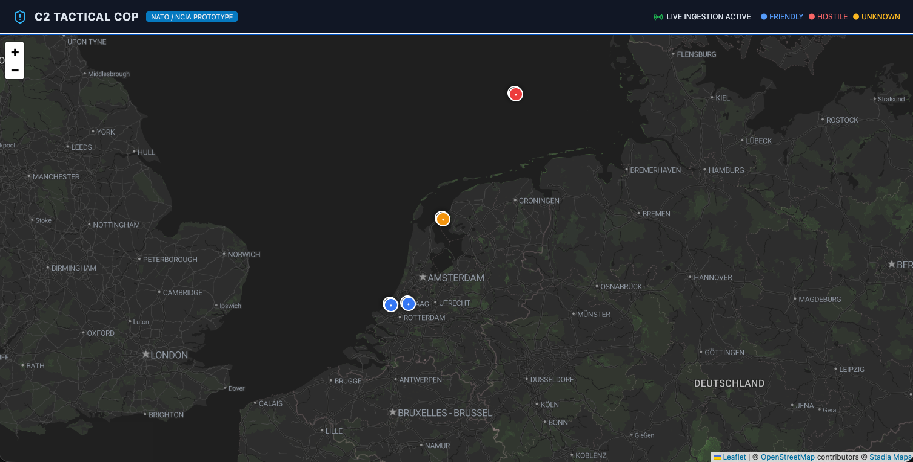
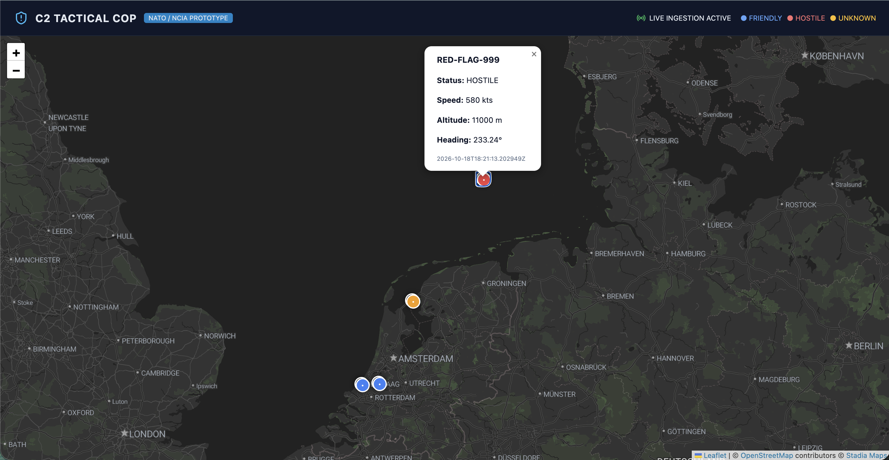
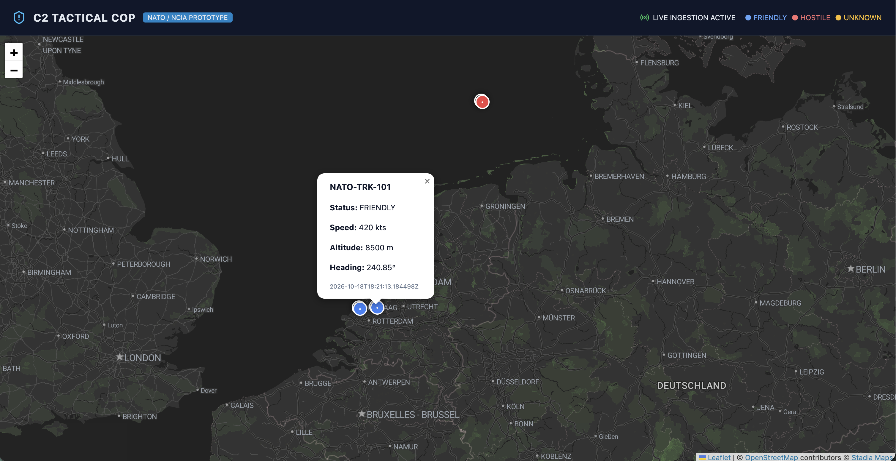
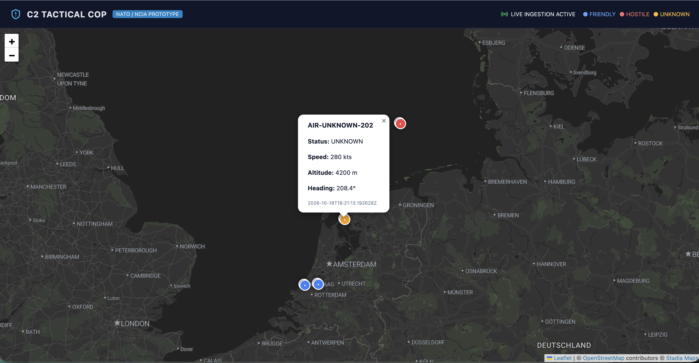

# C2 Tactical COP (Common Operational Picture)


A distributed, military-grade situational awareness platform modeling NATO/NCIA Command & Control (C2) operations. The system processes synthetic radar/telemetry feeds, executes low-latency geospatial persistence, and renders a live Common Operational Picture (COP) with military-spec symbology classification.

---

## Operational Interface

### Common Operational Picture (Theater Overview)


### Real-Time Target Telemetry & Classification

#### Hostile Intercept Telemetry (`RED-FLAG-999`)


#### Friendly Airspace Track (`NATO-TRK-101`)


#### Unidentified Contact Assessment (`AIR-UNKNOWN-202`)


---

## Architecture Overview

```
[ Synthetic Radar / Telemetry Stream ]
                  │
                  ▼ (HTTP POST / TelemetryPayload)
┌──────────────────────────────────────────┐
│      Telemetry Ingestion Microservice    │
│      • Python 3.11 / FastAPI / Pydantic  │
└──────────────┬───────────────────┬───────┘
               │                   │
  (Hot State)  │                   │ (Geospatial Persistence)
               ▼                   ▼
     ┌───────────────────┐   ┌───────────────────────────┐
     │   Redis 7 Cache   │   │   PostgreSQL 15 + PostGIS │
     │  (Sub-ms lookups) │   │  • GiST 2D Spatial Index  │
     └───────────────────┘   └─────────────┬─────────────┘
                                           │
                                           ▼ (JPA / Native Spatial Queries)
┌──────────────────────────────────────────┴┐
│         C2 Enterprise Core Service        │
│         • Java 17 / Spring Boot 3.2       │
│         • Hibernate Spatial / REST API    │
└──────────────────────┬────────────────────┘
                       │
                       ▼ (HTTP Polling / GeoJSON DTO)
┌───────────────────────────────────────────┐
│       Tactical COP Dashboard (React)      │
│       • TypeScript / Leaflet / TanStack   │
│       • Dark-mode Cartographic Basemap    │
└───────────────────────────────────────────┘
```

## Technical Stack

* **Backend Enterprise Service:** Java 17, Spring Boot 3.2, Hibernate Spatial, Spring Data JPA.
* **Telemetry Ingestion Worker:** Python 3.11, FastAPI, Pydantic v2 validation models, `asyncpg`.
* **Geospatial & Storage Layer:** PostgreSQL 15, PostGIS (EPSG:4326, GiST spatial indexing), Redis 7 (in-memory key-value caching).
* **Operator Frontend:** React 18, TypeScript, Leaflet / React-Leaflet, TanStack Query, Lucide Icons.
* **Platform & DevSecOps:** Multi-stage Docker builds, non-root system users (`runAsNonRoot: true`), Linux Debian/Alpine runtimes, declarative Kubernetes manifests, and GitLab CI testing pipelines.

---

## Microservices Breakdown

| Service | Technology | Port | Purpose |
| :--- | :--- | :--- | :--- |
| **`ingestion-service`** | Python / FastAPI | `8000` | Ingests, validates, and routes incoming telemetry feeds. |
| **`c2-core-java`** | Java / Spring Boot | `8080` | Serves situational awareness views and spatial track queries. |
| **`c2-frontend`** | React / Nginx | `3000` | Web dashboard rendering live assets on a dark-mode tactical map. |
| **`c2-db`** | PostgreSQL / PostGIS | `5432` | Relational spatial persistence for chronological track paths. |
| **`c2-redis`** | Redis | `6379` | In-memory distributed hot cache for current asset positions. |

---

## Quick Start (Docker Compose)

### Prerequisites
* Docker Engine 24+ and Docker Compose v2
* Python 3.11+ (to execute the synthetic telemetry generator)

### 1. Launch All Services
```bash
docker compose up -d --build
```

### 2. Verify Database & Spatial Extension
```
docker compose ps
docker exec -it c2-db psql -U nato_operator -d c2_tactical -c "SELECT track_id, ST_AsText(location) FROM asset_tracks;"
```

### 3. Start Telemetry Feed Simulator
Stream continuous aircraft and maritime tracks across the North Sea corridor:
```
docker compose ps
docker exec -it c2-db psql -U nato_operator -d c2_tactical -c "SELECT track_id, ST_AsText(location) FROM asset_tracks;"
```

### 4. Endpoints & Dashboards
* Tactical COP Dashboard: http://localhost:3000
* Spring Boot C2 Endpoint: http://localhost:8080/api/v1/c2/cop/latest
* Ingestion Swagger Documentation: http://localhost:8000/docs

## Kubernetes Deployment
Declarative manifests are located in k8s/:

```
# 1. Apply namespace and credentials
kubectl apply -f k8s/00-namespace-secrets.yaml

# 2. Deploy datastores (PostgreSQL/PostGIS and Redis)
kubectl apply -f k8s/01-datastores.yaml

# 3. Deploy application microservices, health probes, and ingress routing
kubectl apply -f k8s/02-services.yaml
```

## Automated Testing & CI/CD
The platform includes a .gitlab-ci.yml configuration covering automated linting, unit testing, and container verification:

```
# Telemetry payload schema validation
cd backend-ingestion && pytest -v

# Spring Boot unit and integration tests
cd backend-core-java && mvn test

# TypeScript typechecking and static asset compilation
cd frontend-cop && npm run build
```